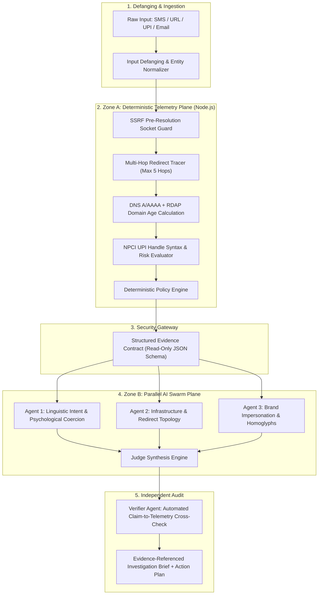

# Scam Swarm v2.0 🛡️
### Autonomous, Evidence-First Multi-Agent Cyber Investigation Platform

[](https://unstop.com)
[](https://www.daiict.ac.in)
[](https://github.com/immanuel-thomas-j/ScamSwarm)
[](https://github.com/immanuel-thomas-j/ScamSwarm)

---

## 🏆 Hackathon Submission Details

| Parameter | Details |
|---|---|
| **Competition** | **RepoReboot ’26** (Organized by **IEEE Student Branch DA-IICT** as part of **i.Fest ’26**) |
| **Institution** | **Dhirubhai Ambani Institute of Information and Communication Technology (DA-IICT)**, Gandhinagar |
| **Track** | **Software Development / AI & Cybersecurity** |
| **Team Name** | **Vyomex** |
| **Team Members** | **Immanuel Thomas J** & **R Hari Krishnan** |
| **Current Stage** | **Evaluation 2 — GitHub Submission (22 October 2026)** |
| **Repository URL** | [https://github.com/immanuel-thomas-j/ScamSwarm](https://github.com/immanuel-thomas-j/ScamSwarm) |

---

## ✅ Round 2 Submission Checklist (RepoReboot ’26)

- [x] **Repository Accessibility**: Repository opens cleanly with structured codebase, package files, and reproducible scripts.
- [x] **Code Availability**: End-to-end multi-agent pipeline, deterministic OSINT engine, and React frontend implemented.
- [x] **Development Traceability**: Clean, logical commit history demonstrating iterative architectural development.
- [x] **PPT Alignment**: Directly mirrors the 5-layer trust boundary architecture and evidence-first principles presented in Round 1.

---

## 💡 Problem Statement & Real-World Motivation

### The Challenge: Bypassing Static Rules and Ungrounded AI
Digital fraud campaigns exploit psychological urgency, brand typosquatting, multi-hop shortener chains, and illicit UPI payment handles. Traditional security controls fail against modern evasion:
1. **Keyword/Regex Defenses**: Miss psychological extortion; fail when messages lack overt malware links or use homoglyphs.
2. **Generic LLM Prompts**: Models hallucinate safety when data is absent and cannot directly query network registries.
3. **Manual SOC Investigation**: Cross-referencing WHOIS and DNS records manually is too slow for real-time alerting.

### 📰 Real-World Incident Case Study
- **Incident**: **₹24 lakh allegedly lost in a Chennai digital-arrest scam** (*The Times of India*, 21 November 2025).
- **Modus Operandi**: Cybercriminals allegedly impersonated law-enforcement officers, using intimidation and financial coercion to pressure an elderly victim into transferring funds to mule accounts.
- **Wider Context**: A separately reported alleged ₹303-crore cyber-fraud network illustrates the scale and complexity of financial cybercrime.
- **Why Scam Swarm Matters**: Isolates coercive language patterns, correlates available technical indicators (domain age, DNS lookup results, including missing or inconclusive data, payment syntax), and produces an **evidence-referenced investigation brief**—without treating an AI-generated suspicion as proof.

> **CRITICAL DISTINCTION FOR JUDGES**: *Real-world incidents establish the severe threat landscape, not the effectiveness of Scam Swarm. Platform efficacy is validated separately via empirical benchmark metrics.*

---

## 📐 Five-Layer Architecture & Security Trust Boundaries

Scam Swarm enforces an **evidence-first invariant**: `UNKNOWN ≠ CLEAN`. A missing record, timeout, or unavailable external intelligence source is bounded to a risk ceiling—never treated as proof of safety.



### 🔒 Defense-in-Depth Security Boundaries
1. **SSRF Pre-Resolution Socket Guard**: Before any outbound HTTP connection is made, hostnames are pre-resolved at the socket level. Outbound requests are blocked if the target IP resolves to private subnets (RFC 1918), loopback (`127.0.0.0/8`, `::1`), or cloud link-local metadata ranges (`169.254.0.0/16`) across all redirect hops.
2. **Structured Evidence Contract**: A strictly typed JSON telemetry contract prevents adversarial prompt injection from overriding deterministic network observations.
3. **Automated Verifier Audit**: An independent verifier audits the generated brief sentence-by-sentence. Any claim not anchored to recorded raw telemetry is stripped before presenting the report to the analyst.

---

## 🔬 Empirical Validation & Benchmark Transparency

Scam Swarm was evaluated against **40 adversarial samples** in [`tests/dataset.json`](file:///tests/dataset.json), comparing three distinct architectural approaches:

| Architecture Tier | Accuracy | Precision | Recall | Specificity | Evidence Coverage |
|---|---|---|---|---|---|
| **Tier 1: Regex & Heuristics** | 75.0% | **100.0%** | 50.0% | **100.0%** | 60.0% |
| **Tier 2: Single-Pass LLM** | **80.0%** | 92.9% | **65.0%** | 95.0% | 65.0% |
| **Tier 3: Full Scam Swarm** | 72.5% | 84.6% | 55.0% | 90.0% | **100.0%** |

### ⚖️ Honest Accuracy vs. Evidence Provenance Trade-Off
- **Highest Raw Accuracy in Tier 2**: On this 40-sample benchmark, Tier 2 (Single-Pass LLM) achieved the highest raw accuracy at **80.0%**.
- **The Evidence Trade-Off**: Tier 2 classifies borderline lures based on linguistic cues alone, but **35% of its assertions lack verifiable network proof**. In contrast, Tier 3 strictly requires verified telemetry backing (**100.0% evidence attribution**), resulting in a more conservative recall (55.0%).
- **Evaluation Scope Limitation**: 40 labeled samples represent a focused preliminary benchmark suite. Broader performance generalizations require evaluation on larger, continuously updated threat corpora.

---

## 💻 Tech Stack & Implementation Details

- **Frontend**: React 19, Vite 8, Tailwind CSS, Responsive Cyberpunk SOC Dashboard
- **Backend**: Node.js, Express, Native DNS resolver (`dns/promises`), HTTP client with socket interception
- **AI Core**: Google Gemini 2.5 Flash (`@google/genai`) & Groq LLaMA 3.3-70B SDK
- **Testing & Benchmarking**: Node.js test harness, automated confusion matrix calculator, regression test suites

---

## 🚀 Quickstart & Local Setup

### 1. Clone the Repository
```bash
git clone https://github.com/immanuel-thomas-j/ScamSwarm.git
cd ScamSwarm
```

### 2. Install Dependencies
```bash
npm install
```

### 3. Configure API Credentials
Create a `.env` file in the root directory:
```env
VITE_GEMINI_API_KEY=your_gemini_api_key_here
VITE_GROQ_API_KEY=your_groq_api_key_here
PORT=3001
```
*(Note: A deterministic fallback engine ensures core OSINT probes and heuristic scoring function even if API keys are omitted).*

### 4. Run Development Servers
In terminal 1 (Backend Server):
```bash
npm run server
```
In terminal 2 (Vite Frontend):
```bash
npm run dev
```
Open [http://localhost:5173](http://localhost:5173) in your browser.

### 5. Reproduce Empirical Benchmark
To reproduce the 40-sample comparative evaluation:
```bash
npm run test:benchmark
```

---

## 👥 Team Vyomex — RepoReboot ’26

- **Immanuel Thomas J** ([@immanuel-thomas-j](https://github.com/immanuel-thomas-j))
- **R Hari Krishnan**

*Organized by IEEE Student Branch DA-IICT as part of i.Fest ’26, Dhirubhai Ambani Institute of Information and Communication Technology (DA-IICT), Gandhinagar.*

> **“Evidence Before AI Conclusions: In cybersecurity, threat assessments must be anchored to verifiable evidence and clear confidence limits.”**
